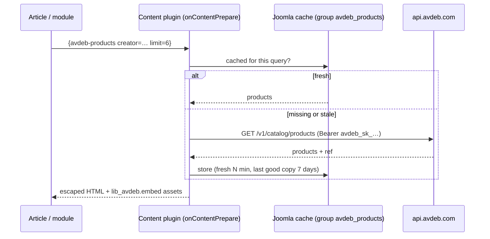

# AVDEB Products for Joomla

Embed [AVDEB](https://avdeb.com/developers/#joomla) products in a Joomla site — a creator's shop, a category, a
search or a single product — with **your referral code on every link**. The Joomla version of
[`emdash-plugin-avdeb`](../emdash-plugin-avdeb/): same catalog client, layouts, card styles and settings.

One installable package (`pkg_avdeb`) for **Joomla 5.4+ and 6.x** (PHP 8.1+):

| Extension | |
|---|---|
| **Content - AVDEB Products** (plugin) | `{avdeb-products …}`, `{avdeb-product …}`, `{avdeb-button …}` tags in articles. Its settings are the site-wide AVDEB settings. |
| **AVDEB Products** (site module) | Products in any template position (sidebar, footer, home page). |
| **Button - AVDEB Products** (editor button) | An **AVDEB** button under the editor: pick a link, layout and count → inserts the tag. |
| **AVDEB Products Library** | Shared PHP code (`Avdeb\Library`), CSS and the carousel script. |

- **Four layouts** — grid, carousel (scroll-snap, keyboard + arrow buttons), list ("shop the post") and spotlight;
  single products as compact card, horizontal card or hero, with your badge and note; plus a button.
- **Looks native** — container queries (embeds adapt to the column they sit in), *match template* / light / dark /
  system themes (match template takes Cassiopeia's or Bootstrap's primary colour), three card styles, accent
  colour, radius, image shape. Styles are `:where()`-wrapped so template CSS wins; a small layout guard keeps
  article styles from cropping images or underlining cards.
- **Fast and resilient** — products are fetched server-side and cached per query in the Joomla cache (works with
  page caching off); the last good copy is served for a week if AVDEB is unreachable; identical embeds on one page
  share one lookup; AVDEB requests are capped at 30 per minute.
- **Honest links** — referral links get `rel="sponsored"`; an optional disclosure appears under embeds that carry a
  code.
- **Private by default** — no third-party scripts, cookies, iframes or tracking. The only JS is the ~40-line
  carousel script. The secret key stays on the server.
- **Admin status** — the plugin settings show "Connected as …", the referral code in use, a live preview, request
  stats and **Refresh products now**.

## Install

Download `pkg_avdeb-x.y.z.zip` → **System → Install → Extensions → Upload Package File**. The content plugin and the
editor button are enabled automatically on first install.

Then open **System → Plugins → Content - AVDEB Products**:

| Setting | |
|---|---|
| **Secret key** | Optional, recommended. `avdeb_sk_…` from the partner dashboard → *Embeds & API*. Your referral code is added automatically and embeds can show up to 48 products. Used only on the server. |
| **Referral code** | Used only without a key: added as `?ref=` to every link (max 12 products per embed). |
| **Affiliate disclosure** | Shown under embeds whose links carry a referral code (e.g. US FTC rules). |
| Layout, columns, card style, colours, accent, radius, image shape, button text, prices / designers / badges / new tab | Site-wide defaults — every tag and module can override them. |
| Refresh every | Cache lifetime in minutes (default 360). |

Without a key or code everything still works with plain AVDEB links.

## In articles

```
{avdeb-products https://avdeb.com/creators/your-slug/ layout="carousel" limit="8" heading="From my shop"}
{avdeb-products https://avdeb.com/category/stickers/ columns="4" card-style="outline"}
{avdeb-products cat stickers layout="list" limit="3" heading-level="3"}
{avdeb-product https://avdeb.com/store/cat-sticker/ variant="hero" badge="Editor's pick" note="I use it every day."}
{avdeb-button href="/creators/your-slug/" label="Visit my shop" variant="outline" align="center"}
```

The first bare value is the link or search phrase; paste any avdeb.com creator (`/creators/…`), category
(`/category/…`) or product (`/store/…`) link and the source is detected. Attributes:

| | |
|---|---|
| `source` | `auto` (default), `creator`, `tag`, `type`, `search`, `newest` — or the shorthands `creator="…"`, `tag="…"`, `type="…"`, `q="…"`, `handle="…"` |
| `limit`, `layout`, `columns` | 1–48, `grid` / `carousel` / `list` / `spotlight`, 1–6 |
| `heading`, `intro`, `view-all`, `heading-level` | Collection header (`view-all="false"` hides "View all"; heading level 2–5, card titles one below) |
| `variant`, `badge`, `note` | Single product: `horizontal` / `hero` / `card` |
| `card-style`, `theme`, `accent-color`, `radius`, `image-ratio`, `cta-label` | Override the site defaults (`theme`: `site` / `light` / `dark` / `auto`) |
| `hide-price`, `hide-creator`, `show-badges`, `new-tab` | Flags / `"true"`/`"false"` |

Tags that sit alone in a paragraph replace the whole `<p>`; quotes mangled by editors (`&quot;`, curly quotes) are
fine. Write `{{avdeb-products …}}` to show a tag literally. Tags are removed from Smart Search indexing. They also
work in **Custom** modules with *Prepare Content* on.

## In module positions

**Content → Site Modules → New → AVDEB Products**: link or search, several products or one featured product,
number, intro, "View all"; the *Display* tab overrides the plugin defaults ("Use Global" = plugin setting). Card
titles use the heading level below the module title. Template override: `html/mod_avdeb_products/default.php`.

## Theming

Everything is a CSS custom property on `.avdeb` (embeds) or `.avdeb-cta` (buttons) — add to your template's
`user.css`:

```css
.avdeb { --avdeb-accent: #4d7f5a; --avdeb-radius: 20px; --avdeb-gap: 1.25rem; --avdeb-font-title: "Fraunces", serif; }
.avdeb[data-theme="dark"] { --avdeb-card-bg: #111; }
```

All `--avdeb-*` properties and the stable BEM classes (`.avdeb-card__title`, `.avdeb-badge--sale`, …) are listed in
the [EmDash README](../emdash-plugin-avdeb/README.md#theming).

## How it works



## Become an AVDEB affiliate (or creator)

[avdeb.com/affiliate](https://avdeb.com/affiliate/) — 5% commission, 30-day cookie, monthly PayPal payouts in USD
($50 minimum), open worldwide. Apply at [avdeb.com/affiliate/apply](https://avdeb.com/affiliate/apply/), then
create a secret key under **Embeds & API** in the
[partner dashboard](https://avdeb.com/affiliate/dashboard/developers/) and paste it into the plugin settings.

## Development

```sh
php tests/run.php     # 36 tests, no Composer needed (PHP 8.1+)
php build.php         # → dist/pkg_avdeb-0.1.0.zip (uses ext-zip, or the zip CLI)
```

```
pkg_avdeb.xml, script.php        package manifest + installer (enables the plugins on first install)
lib_avdeb/src/Catalog.php        catalog API contract (port of catalog.ts)
lib_avdeb/src/Client.php         cache: fresh / stale / back-off, request budget, key check (port of client.ts)
lib_avdeb/src/Options.php        embed options + site defaults, link → query
lib_avdeb/src/View.php           card view models, prices, badges, "View all"
lib_avdeb/src/Renderer.php       HTML (same markup as Embed.astro), button
lib_avdeb/src/Shortcodes.php     {avdeb-…} tag parsing
lib_avdeb/src/Embeds.php         Joomla facade: settings, cache store, HTTP, assets, admin status
lib_avdeb/media/                 avdeb.css (shared card styles), avdeb.js (carousel), joomla.asset.json
plg_content_avdeb/               tags, settings form, status field, com_ajax "refresh"
plg_editors-xtd_avdeb/           editor button + dialog (editor-api, joomla.dialog)
mod_avdeb_products/              site module
```

## License

GNU General Public License version 2 or later (required for the Joomla Extensions Directory).
